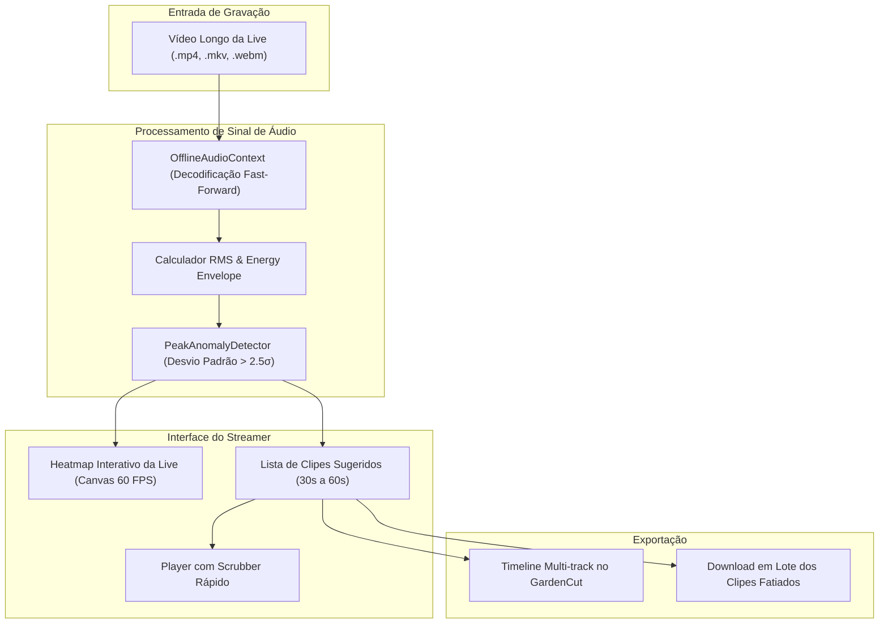

# 🌿 Garden Stream Highlights

> **Detector Inteligente de Melhores Momentos & Cortador de Clipes de Lives (VODs de 1h a 4h)** com análise acústica de picos de emoção/gritos, telemetria de chat e exportação direta para a timeline do **GardenCut**.

---

## 🎯 Por que o Garden Stream Highlights?

Streamers na Twitch, YouTube e Kick transmitem de 2 a 6 horas por dia. O trabalho mais cansativo pós-live é reassistir a gravação inteira (VOD) procurando os 3 ou 4 momentos engraçados, jogadas épicas ou reações que valem um clipe de 30 a 60 segundos para postar nas redes sociais.

O **Garden Stream Highlights automatiza essa mineração no próprio navegador**:
* **Varredura Acústica de Picos (Acoustic Excitement Detection):** Analisa a forma de onda do áudio procurando subidas súbitas de energia sonora (gritos, risadas intensas, sustos e comemorações) com janelas de análise configuráveis.
* **Mapa de Calor da Live (Highlight Heatmap):** Exibe uma linha do tempo completa da live colorida por intensidade dramática (azul para calmo, amarelo para engajamento e vermelho para picos épicos).
* **Fatiador com Janela Inteligente:** Ao detectar um pico no segundo 1.450, o software recorta automaticamente do segundo 1.435 ao 1.475 (15 segundos antes para dar contexto e 25 segundos depois para mostrar o desfecho).
* **Pré-visualização Rápida:** Player com scrubber veloz para aprovar ou descartar clipes com atalhos de teclado (<kbd>A</kbd> para aprovar, <kbd>D</kbd> para descartar).
* **Exportação em 1 Clique para o GardenCut:** Envia a lista de clipes aprovados direto para a timeline do [GardenCut](https://github.com/FelipeGardenghiDev/garden-cut) para aplicar legendas cinéticas do **Garden Subtitle** e reenquadramento vertical do **Garden Auto-Framer**.

---

## 🏛️ Arquitetura do Software

---

## 🛠️ Stack Tecnológica

* **Linguagem:** TypeScript 5.8+
* **Framework:** React 19 + Vite 8
* **Análise de Sinal:** Web Audio API (`OfflineAudioContext`, `AudioBuffer`)
* **Visualização Gráfica:** HTML5 Canvas 2D de alta performance
* **Persistência Local:** IndexedDB (para armazenar projetos de VOD pesados)

---

## 🌿 Ecossistema GC Studio

Este projeto integra o ecossistema de aplicações criativas mantidas pelo estúdio **GC Studio** (Felipe Gardenghi).  
Para conhecer outras ferramentas da suíte:
* 🎬 **[GardenCut](https://github.com/FelipeGardenghiDev/garden-cut):** Editor de vídeo não-linear web.
* 📱 **[Garden Auto-Framer](https://github.com/FelipeGardenghiDev/garden-auto-framer):** Reenquadrador vertical para Shorts/TikTok.
* 🕹️ **[Garden StreamDeck](https://github.com/FelipeGardenghiDev/garden-streamdeck):** Mesa de controle sem fio para OBS.
* 🏛️ **[GC Studio Hub](https://github.com/FelipeGardenghiDev/gcstudio):** Central oficial do estúdio.

---

## 📄 Licença
Distribuído sob a licença MIT. Criado por Felipe Gardenghi.
